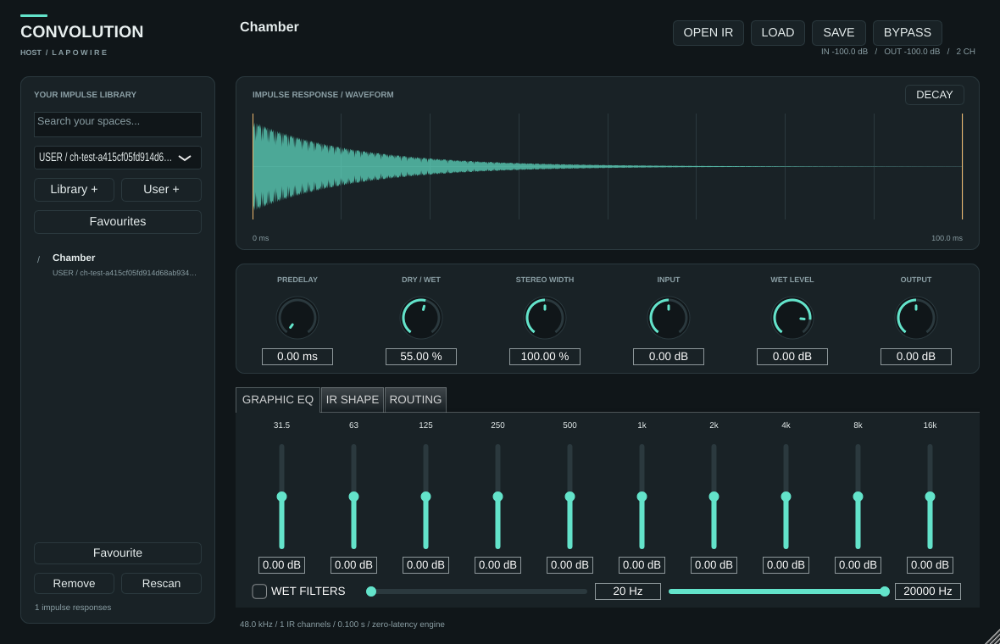

# CONVOLUTION HOST

Riverbero a convoluzione in **C++20 / JUCE 8**, con interfaccia nativa e librerie di impulse response WAV. Questo repository contiene la prima versione di sviluppo mono/stereo; il progetto completo è descritto nella [specifica](docs/superpowers/specs/2026-10-19-convolution-host-design.md).



*Anteprima generata dal test della GUI con un IR sintetico.*

## Funzioni implementate

- Convoluzione FFT partizionata a latenza dichiarata zero; IR fino a 30 secondi a 96 kHz entro il budget del motore.
- Mono, dual mono, stereo e true stereo con quattro percorsi LL/LR/RL/RR, da WAV multicanale o quattro WAV mono separati.
- Caricamento asincrono, ricampionamento, crossfade di 50 ms e conservazione del motore precedente se il nuovo caricamento fallisce.
- Predelay, mix, WIDTH stereo, gain input/wet/output, EQ grafico a dieci bande e filtri wet.
- Waveform per canale, decadimento energetico, trim, fade e normalizzazione comune dei canali.
- Directory multiple per librerie e IR utente, ricerca, preferiti, drag-and-drop, preset e stato della sessione versionato.
- Recupero degli IR spostati tramite radici della libreria e verifica SHA-256 del contenuto, anche per i quattro file true stereo.

Nessuna libreria IR commerciale è inclusa. I WAV originali non vengono modificati. Senza IR valido l'audio passa a guadagno unitario.

## Compilazione su Linux

Servono CMake ≥3.22, un compilatore C++20 e le dipendenze di sistema JUCE. Su Debian/Ubuntu:

```sh
sudo apt-get update
sudo apt-get install -y cmake libasound2-dev libx11-dev libxext-dev \
  libxinerama-dev libxrandr-dev libxcursor-dev libfreetype6-dev \
  libfontconfig1-dev libfftw3-dev xvfb
cmake -S . -B build -DCMAKE_BUILD_TYPE=Release
cmake --build build --parallel 2
xvfb-run -a ctest --test-dir build --output-on-failure
```

Su Linux il motore usa FFTW3f collegato direttamente per evitare il backend FFT di ripiego con scratch allocato durante il callback. Su macOS JUCE usa vDSP.

CMake scarica JUCE a un commit esatto e verifica lo SHA-256 dell'archivio. Per una copia locale verificata usare `-DFETCHCONTENT_SOURCE_DIR_JUCE=/percorso/JUCE`.

Output:

- `build/ConvolutionHost_artefacts/Release/VST3/CONVOLUTION HOST.vst3`
- `build/ConvolutionHost_artefacts/Release/Standalone/CONVOLUTION HOST`

Per compilare soltanto il core e i suoi test: `-DCH_BUILD_PLUGIN=OFF`. I test DSP non richiedono scheda audio; i test dell'editor usano un display, anche virtuale.

### Ambiente cloud senza root

Nella macchina Debian cloud di questo progetto:

```sh
bash scripts/setup-cloud.sh
source /workspace/toolchain/activate.sh
Xvfb :99 -screen 0 1400x900x24 -nolisten tcp > /tmp/convolution-xvfb.log 2>&1 &
DISPLAY=:99 ctest --test-dir build --output-on-failure
```

Lo script conserva strumenti, header e librerie in `/workspace/toolchain`, verificando gli indici firmati Debian, e usa il checkout JUCE verificato in `/workspace/deps/JUCE`. Non modifica il sistema. Se il display `:99` esiste già, riutilizzarlo o sceglierne uno libero. Una macchina cloud senza dispositivo audio permette test offline e GUI, non una prova d'ascolto in tempo reale.

## Uso

1. Avviare Standalone oppure inserire il VST3 nella DAW; aprire un WAV con **OPEN IR**, trascinarlo sulla GUI o selezionarlo nella libreria.
2. Aggiungere directory con **Library +** e **User +**. **Remove** rimuove soltanto la radice dalla configurazione.
3. Regolare mix, predelay e WIDTH; le pagine inferiori espongono EQ, **IR SHAPE** e **ROUTING**. Le bande oltre Nyquist vengono disabilitate.
4. In **IR SHAPE**, `END = 0` usa tutta la durata. Il trim si può anche selezionare trascinando sulla waveform.
5. Per true stereo, scegliere il WAV multicanale e assegnare i canali, oppure selezionare **four mono WAV files** e scegliere i quattro file. Premere **Apply routing**. L'ordine non viene dedotto dal nome del file.
6. **SAVE / LOAD** gestisce preset `.chpreset`. I preset conservano riferimenti ai WAV, senza incorporarli: per trasferirli occorre trasferire anche gli IR e configurare le radici della libreria.

Le modifiche di trim/fade/normalizzazione richiedono una preparazione asincrona dell'IR. Non sono adatte a modulazione audio-rate; la richiesta più recente sostituisce quelle superate.

## Verifica e limiti attuali

I test confrontano l'audio con una convoluzione diretta, provano routing e isolamento dei canali, sample rate e blocchi variabili, EQ, predelay, file corrotti, caricamenti concorrenti, sostituzioni, stato, rilocalizzazione e GUI ridimensionabile. I controlli di `new/delete` e, su Linux, di `malloc/calloc/realloc/free` intercettabili dal linker sul thread di test integrano l'audit del callback; non equivalgono a un analizzatore completo delle chiamate interne alle librerie dinamiche. Il test dell'editor produce `build/ui-preview.png` con un IR sintetico.

VST3 e Standalone sono i target di questa fase. Multicanale immersivo, AmbiX, CLAP, AU e AAX restano nella roadmap: non vengono simulati tramite un bus stereo. AU richiede macOS; AAX richiede SDK Avid e condizioni di distribuzione appropriate. Bed/oggetti Atmos saranno elaborati come canali esposti dalla DAW, mantenendo metadati e rendering nell'host.

La compilazione e il rendering offline non certificano la compatibilità con ogni DAW. Firma, notarizzazione, installer e verifiche su hardware audio sono attività successive. Gli IR lunghi e le matrici dense richiedono misure CPU sulla macchina di destinazione; il limite di 512 MiB è una stima conservativa dei motori, non della memoria totale del processo.

## Licenza

Il repository mantiene la [GPL-3.0](LICENSE). Prima della distribuzione verificare anche le condizioni JUCE, FFTW e degli SDK utilizzati.
