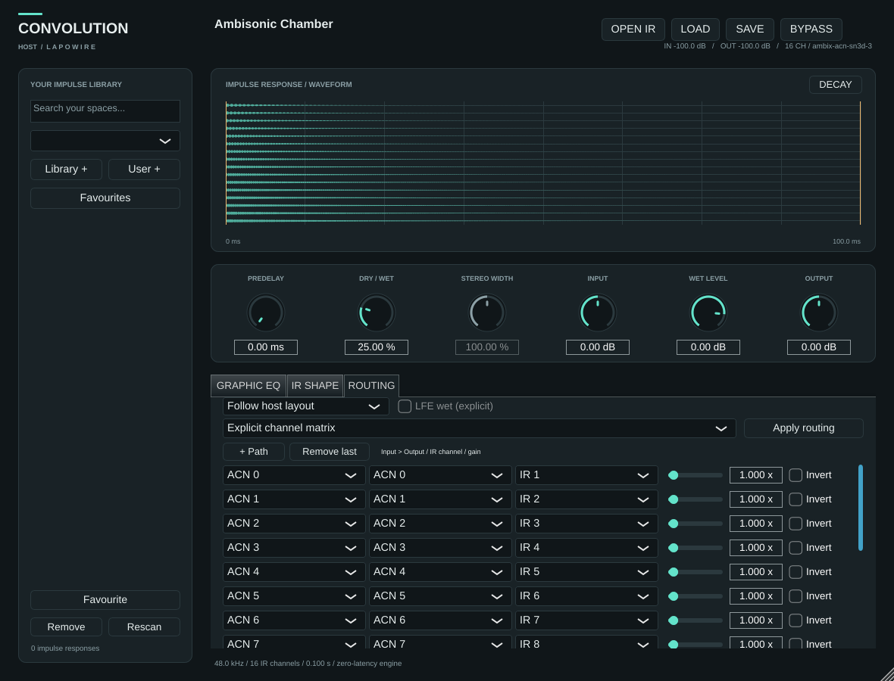

# CONVOLUTION HOST

Riverbero a convoluzione in **C++20 / JUCE 8**, con interfaccia nativa e librerie di impulse response WAV. Questo repository contiene la versione di sviluppo 0.2 con bus fino a 16 canali; il progetto completo è descritto nella [specifica](docs/superpowers/specs/2026-10-19-convolution-host-design.md).


*Anteprima generata dal test della GUI con un IR sintetico.*

La cartella [BUILD](BUILD/README.md) documenta la consegna finale richiesta per Linux, Windows e macOS. La build Linux multicanale è compilata e testata; le consegne Windows/macOS dipendono dai job nativi. Stato e download sono descritti nella cartella BUILD.

## Funzioni implementate

- Convoluzione FFT partizionata a latenza dichiarata zero; IR fino a 30 secondi a 96 kHz entro il budget del motore.
- Mono, dual mono, stereo e true stereo con quattro percorsi LL/LR/RL/RR, da WAV multicanale o quattro WAV mono separati.
- Matrice sparsa fino a 256 percorsi e 16 canali, layout 5.1/7.1/7.1.2/7.1.4 e AmbiX ACN/SN3D ordini 1–3. LFE wet richiede consenso esplicito; WIDTH è disabilitato nei layout senza coppie stereo.
- Caricamento asincrono, ricampionamento, crossfade di 50 ms e conservazione del motore precedente se il nuovo caricamento fallisce.
- Predelay, mix, WIDTH stereo, gain input/wet/output, EQ grafico a dieci bande e filtri wet.
- Waveform per canale, decadimento energetico, trim, fade e normalizzazione comune dei canali.
- Directory multiple per librerie e IR utente, ricerca, preferiti, drag-and-drop, preset e stato della sessione versionato.
- Recupero degli IR spostati tramite radici della libreria e verifica SHA-256 del contenuto, anche per i quattro file true stereo.

Nessuna libreria IR commerciale è inclusa. I WAV originali non vengono modificati. Senza IR valido l'audio passa a guadagno unitario.

## Compilazione su Linux

Servono CMake ≥3.22, un compilatore C++20, Python ≥3.9 per verifiche/packaging e le dipendenze di sistema JUCE. Su Debian/Ubuntu:

```sh
sudo apt-get update
sudo apt-get install -y cmake libasound2-dev libx11-dev libxext-dev \
  libxinerama-dev libxrandr-dev libxcursor-dev libfreetype6-dev \
  libfontconfig1-dev xvfb
cmake -S . -B .build -DCMAKE_BUILD_TYPE=Release
cmake --build .build --parallel 2
xvfb-run -a ctest --test-dir .build --output-on-failure
```

Su Linux/Windows il motore usa FFTW3f statico con pianificazione senza buffering dinamico; CMake scarica la versione 3.3.10 a SHA-256 fissato e applica un adattamento documentato al planner. Il provider di sistema viene rifiutato perché non garantisce questo comportamento. Su macOS JUCE usa vDSP.

CMake scarica JUCE a un commit esatto e verifica lo SHA-256 dell'archivio. Per una copia locale verificata usare `-DFETCHCONTENT_SOURCE_DIR_JUCE=/percorso/JUCE`.

Output:

- `.build/ConvolutionHost_artefacts/Release/VST3/CONVOLUTION HOST.vst3`
- `.build/ConvolutionHost_artefacts/Release/CLAP/CONVOLUTION HOST.clap`
- `.build/ConvolutionHost_artefacts/Release/Standalone/CONVOLUTION HOST`

Per compilare soltanto il core e i suoi test: `-DCH_BUILD_PLUGIN=OFF`. I test DSP non richiedono scheda audio; i test dell'editor usano un display, anche virtuale.

### Ambiente cloud senza root

Nella macchina Debian cloud di questo progetto:

```sh
bash scripts/setup-cloud.sh
source /workspace/toolchain/activate.sh
Xvfb :99 -screen 0 1400x900x24 -nolisten tcp > /tmp/convolution-xvfb.log 2>&1 &
DISPLAY=:99 ctest --test-dir .build --output-on-failure
```

Lo script conserva strumenti, header e librerie in `/workspace/toolchain`, verificando gli indici firmati Debian, e usa il checkout JUCE verificato in `/workspace/deps/JUCE`. Non modifica il sistema. Se il display `:99` esiste già, riutilizzarlo o sceglierne uno libero. Una macchina cloud senza dispositivo audio permette test offline e GUI, non una prova d'ascolto in tempo reale.


## Build Windows/macOS e cartella BUILD

La workflow [Native plugin builds](https://github.com/Lapowire/CONVOLUTION-HOST/actions/workflows/build.yml) usa runner Windows x64 e macOS universal, oltre a Linux. Include VST3/CLAP/Standalone ovunque, AU su macOS e AAX su Windows/macOS. Un formato richiesto ma non disponibile provoca un errore esplicito. Gli intermedi vanno sempre in `.build`, mai in `BUILD`.

Su Windows usare Visual Studio 2022 con C++ e `cmake -S . -B .build -A x64`, poi `cmake --build .build --config Release --parallel 2`. Su macOS aggiungere `-DCMAKE_OSX_ARCHITECTURES="arm64;x86_64" -DCMAKE_OSX_DEPLOYMENT_TARGET=11.0` alla configurazione Release. Per i test multi-config aggiungere `-C Release` a CTest.

Gli script di test e consegna richiedono Python 3.12 o successivo. Per raccogliere una build Release pulita e già testata su Linux:

```sh
python3 scripts/test-report.py --run --build-dir .build --junit .build/test-results.xml --output .build/test-results.json --artifacts .build/ConvolutionHost_artefacts/Release --provenance .build/build-provenance-Release.json
python3 scripts/check-native-artifacts.py --platform linux --artifacts .build/ConvolutionHost_artefacts/Release
python3 scripts/stage-build.py --artifacts .build/ConvolutionHost_artefacts/Release --provenance .build/build-provenance-Release.json --test-results .build/test-results.json --output BUILD
python3 scripts/verify-delivery.py --archive BUILD/archives/convolution-host-0.2.0-Linux-x86_64.tar.gz
```

Su Linux headless eseguire il comando `test-report.py --run` sotto Xvfb. Il comando esegue CTest, controlla l’identità compilata e registra gli hash dei file prima e dopo i test; importare un XML preesistente non autorizza lo staging. Lo staging richiede commit corrispondente, sorgenti puliti, tutti i formati nativi previsti e test verdi. Conserva i bundle da copiare nelle cartelle della DAW, i permessi e le licenze; produce manifest e checksum. Vedere [BUILD](BUILD/README.md) per i percorsi di installazione e gli archivi. La build cloud corrente richiede GLIBC ≥2.38 e GLIBCXX ≥3.4.32; le build della CI hanno la propria baseline.



## Uso

1. Avviare Standalone oppure inserire il VST3 nella DAW; aprire un WAV con **OPEN IR**, trascinarlo sulla GUI o selezionarlo nella libreria.
2. Aggiungere directory con **Library +** e **User +**. **Remove** rimuove soltanto la radice dalla configurazione.
3. Regolare mix, predelay e WIDTH; le pagine inferiori espongono EQ, **IR SHAPE** e **ROUTING**. Le bande oltre Nyquist vengono disabilitate.
4. In **IR SHAPE**, `END = 0` usa tutta la durata. Il trim si può anche selezionare trascinando sulla waveform.
5. Per true stereo, scegliere il WAV multicanale e assegnare i canali, oppure selezionare **four mono WAV files** e scegliere i quattro file. Premere **Apply routing**. L'ordine non viene dedotto dal nome del file.
6. Per bus multicanale, scegliere **Explicit channel matrix**, aggiungere percorsi, assegnare ingressi/uscite/IR e regolare gain/polarità. **Apply routing** conferma. **LFE wet** va abilitato esplicitamente. Su bus discreti 4/9/16 è possibile scegliere AmbiX ACN/SN3D; non viene dedotto automaticamente.
7. **SAVE / LOAD** gestisce preset `.chpreset`. I preset conservano riferimenti ai WAV, senza incorporarli: per trasferirli occorre trasferire anche gli IR e configurare le radici della libreria.

Le modifiche di trim/fade/normalizzazione richiedono una preparazione asincrona dell'IR. Non sono adatte a modulazione audio-rate; la richiesta più recente sostituisce quelle superate.

## Verifica e limiti attuali

La build Release Linux supera 91 casi in 10 gruppi CTest (45 core, 22 processor/GUI, 21 Python e 3 test dei moduli). I moduli reali verificano anche 9 configurazioni VST3 e 25 CLAP, inclusi metadati surround e AmbiX. Risultati, correzioni della revisione e problemi minori ancora aperti sono elencati nello [stato di sviluppo](docs/development-status.md).

I test confrontano l'audio con una convoluzione diretta, provano routing e isolamento dei canali, sample rate e blocchi variabili, EQ, predelay, file corrotti, caricamenti concorrenti, sostituzioni, stato, rilocalizzazione e GUI ridimensionabile. I controlli di `new/delete` e, su Linux, di `malloc/calloc/realloc/free` intercettabili dal linker sul thread di test integrano l'audit del callback; non equivalgono a un analizzatore completo delle chiamate interne alle librerie dinamiche. Il test dell'editor produce `.build/ui-preview.png` con un IR sintetico.

VST3, CLAP e Standalone sono compilati e verificati su Linux. I target AU/AAX e le applicazioni macOS/Windows sono configurati nella CI nativa; la loro esecuzione non è stata verificata da questa sessione. Gli SDK sono inclusi nel JUCE fissato; la firma Avid/PACE resta necessaria per la distribuzione AAX in Pro Tools. I canali di bed/oggetti esposti dalla DAW sono elaborati come audio; metadati e rendering Atmos restano nell’host.

La compilazione e il rendering offline non certificano la compatibilità con ogni DAW. Firma, notarizzazione, installer e verifiche su hardware audio sono attività successive. Gli IR lunghi e le matrici dense richiedono misure CPU sulla macchina di destinazione; il limite di 512 MiB è una stima conservativa dei motori, non della memoria totale del processo.

## Licenza

Il repository mantiene la [GPL-3.0](LICENSE). Le build di sviluppo usano l’opzione AGPLv3 di JUCE 8 e includono gli avvisi delle dipendenze: vedere [licenze delle build](docs/dependency-licenses.md).
