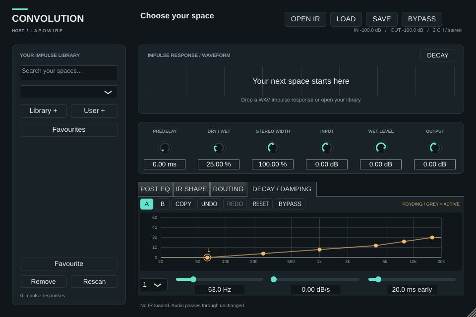

# EQ parametrico e damping

POST EQ modifica il timbro del segnale wet dopo la convoluzione. Selezionare un
nodo oppure il suo numero: trascinare orizzontalmente per cambiare frequenza e
verticalmente per cambiare gain; la rotella regola Q. I campi sotto il grafico
consentono valori numerici. Frecce sinistra/destra cambiano frequenza,
su/giù cambiano gain; Pagina su/giù selezionano il nodo precedente/successivo.
Doppio click azzera il gain. Il notch ha profondità fissa e non usa il gain.

Le dieci bande offrono bell, low shelf, high shelf e notch, gain ±12 dB e Q
0,1–18. La curva principale mostra la risposta totale, compresi gli HP/LP se
attivi; la curva tenue mostra la banda selezionata. BYPASS del pannello esclude
le dieci bande parametriche; WET FILTERS controlla separatamente HP/LP. I nodi
oltre Nyquist sono inattivi e mantengono la frequenza salvata.

DECAY / DAMPING modifica invece l'IR in background. Ogni nodo indica i **dB/s di
attenuazione aggiuntiva** a una frequenza: zero conserva il decadimento; 12 dB/s
rimuove nominalmente 12 dB dopo un secondo oltre la protezione iniziale. La
curva interpola in frequenza logaritmica. La trasformazione spettrale ha una
risoluzione temporale finita, quindi il valore non è un RT60 misurato né una
soglia esatta al singolo campione. Non genera né allunga code.

Il controllo «ms early» protegge nominalmente i primi 0–200 ms dalla selezione
trim, con valore iniziale 20 ms. La stessa curva viene applicata a tutti i
canali, senza normalizzazione successiva e senza modificare il WAV originale.
La curva neutra o BYPASS lascia invariati i campioni preparati. Le anteprime
waveform/Schroeder si aggiornano dopo la preparazione del nuovo IR.

Le modifiche damping sono raggruppate dopo 150 ms senza altri interventi;
preparazione e crossfade seguono in modo asincrono. Durante l'attesa la curva
grigia indica il damping attivo e quella colorata la richiesta. In caso di
errore il motore precedente rimane attivo. L'automazione damping non è
sample-accurate: prima di esportare attendere APPLIED e l'applicazione durante
l'elaborazione audio. Senza IR caricato il pannello indica SELECT AN IR.

A e B confrontano due configurazioni dell'intero EQ/damping; COPY copia quella
attiva nell'altra. RESET ripristina solo il pannello corrente. UNDO e REDO
raggruppano ogni trascinamento in un'azione, con massimo 128 azioni locali.
Le modifiche provenienti dalla DAW non vengono aggiunte alla cronologia; undo
non sovrascrive i parametri modificati successivamente dall'automazione esterna.
Le memorie A/B sono incluse nel preset; la cronologia undo non viene salvata.

Lo stato versione 3 legge anche le versioni 1 e 2, conservando i gain dell'EQ
precedente e assegnando frequenze originali, Q 1,4 e damping neutro ai controlli
nuovi. Gli identificatori e l'ordine dei parametri già pubblicati sono mantenuti.

